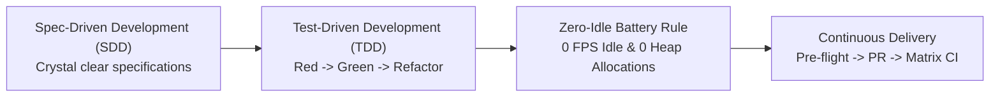
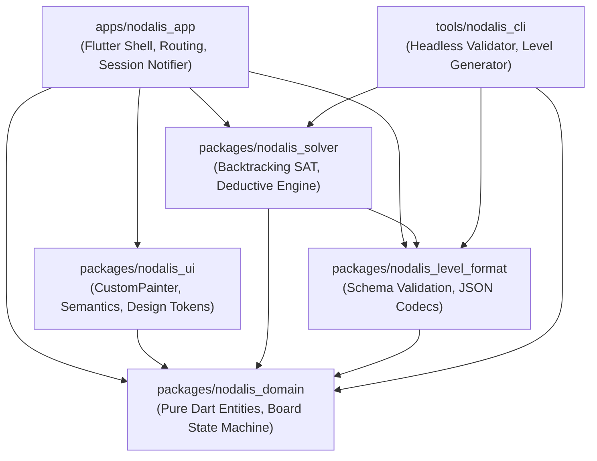
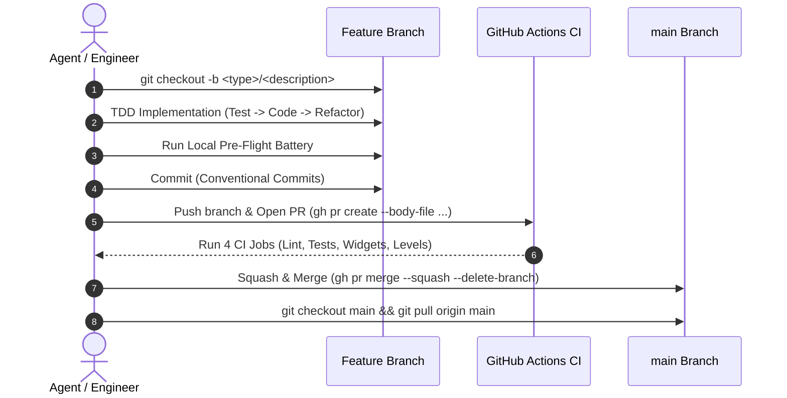

# AGENTS.md — Agentic Engineering Guidelines & System Contract

> **Nodalis**: A modern, premium, calm logic puzzle game designed for focused problem-solving, exceptional performance, and battery efficiency across mobile (iOS, Android) and web (WASM).
> Built with **Flutter (Stable)**, **Pure Dart 3**, **CustomPainter**, and **Riverpod**.

---

## 1. Core Engineering Philosophy

All AI agents and engineers operating in this repository must strictly adhere to four foundational pillars:



### Pillar 1: Spec-Driven Development (SDD)
- **Target Clarity**: Never write production code without an explicit specification, defined requirements, clear input/output contracts, error conditions, and acceptance criteria.
- **Specification Documentation**: High-level designs and architectural decisions are committed to [`docs/ARCHITECTURE.md`](file:///home/aitor/projects/nodalis/docs/ARCHITECTURE.md) and [`docs/CONTRACT.md`](file:///home/aitor/projects/nodalis/docs/CONTRACT.md).
- **Zero Ambiguity**: Resolve architectural ambiguities or user intent before modifying core state machines.

### Pillar 2: Test-Driven Development (TDD)
- **Red $\to$ Green $\to$ Refactor**:
  1. **Red**: Write a failing test exercising the expected behavior, domain rule, or bug report.
  2. **Green**: Implement the minimal, clean code required to pass the test.
  3. **Refactor**: Eliminate warnings, ensure zero formatting errors (`dart format`), and optimize performance.
- **Testing Pyramid**:
  - **Unit Tests** (`packages/nodalis_domain/test/`, `packages/nodalis_solver/test/`): 100% test coverage mandatory for domain entities, invariants, and solvers.
  - **Format & Serialization Tests** (`packages/nodalis_level_format/test/`): Schema roundtrips and migration integrity.
  - **Widget & Screen Tests** (`packages/nodalis_ui/test/`, `apps/nodalis_app/test/`): Gesture detection, accessibility semantics tree, screen flows, and atomic persistence.
  - **Headless Content Validation** (`tools/nodalis_cli/bin/nodalis.dart validate-all`): Headless graph solvability and uniqueness proofs.

### Pillar 3: Zero-Idle Battery & Frame Pacing Invariants
- **0 FPS Idle Rule**: When the user is not actively interacting (dragging/tapping) or observing a discrete micro-animation (e.g. 150ms bridge placement), frame rate MUST be **strictly 0 FPS**. No continuous tickers, infinite ambient particle loops, or polling timers.
- **Zero Heap Allocations in Paint Loops**: The `CustomPainter.paint(Canvas, Size)` method must allocate **0 objects** on the heap. All `Paint`, `Path`, `TextStyle`, and `TextPainter` instances must be pre-allocated and cached in state.
- **Repaint Boundaries**: The puzzle canvas must be isolated within a `RepaintBoundary` to decouple board painting from navigation and UI chrome.

### Pillar 4: Atomic State Persistence
- **Crash & Force-Stop Resilience**: Player progress, level unlocks, and in-progress board states (bridges placed, move counts) must be written atomically to disk (single-key JSON store `nodalis_player_store_v2`) to eliminate concurrent IPC race conditions during Android/iOS app termination.

---

## 2. Monorepo Architecture & Physical Boundaries

Nodalis is organized as a native Dart 3.5+ multi-package workspace following hexagonal architecture:



### Package Responsibilities & Boundary Rules

| Package / Directory | Purpose | Boundary Invariant |
| :--- | :--- | :--- |
| [`packages/nodalis_domain`](file:///home/aitor/projects/nodalis/packages/nodalis_domain) | Pure Dart rules engine, board entities (`Island`, `Bridge`, `Board`), immutable state transitions (`Result<Board, DomainFailure>`). | **STRICTLY PURE DART**: Zero Flutter, zero UI, zero I/O imports. Standard Dart SDK only. |
| [`packages/nodalis_level_format`](file:///home/aitor/projects/nodalis/packages/nodalis_level_format) | Level serialization, JSON schema validation, version migrations. | Depends ONLY on `nodalis_domain` and Dart standard libraries. |
| [`packages/nodalis_solver`](file:///home/aitor/projects/nodalis/packages/nodalis_solver) | Backtracking constraint solver, solution uniqueness verification ($N=1$), human-like deductive hint engine. | Headless & pure. Never import UI or Flutter widgets. Run heavy computations in background isolates if duration exceeds 16ms. |
| [`packages/nodalis_ui`](file:///home/aitor/projects/nodalis/packages/nodalis_ui) | Design system, visual tokens, zero-heap `BoardPainter`, `BoardGestureDetector`, TalkBack/VoiceOver semantics. | Depends on `nodalis_domain` and Flutter SDK. |
| [`apps/nodalis_app`](file:///home/aitor/projects/nodalis/apps/nodalis_app) | Application shell, dependency injection (Riverpod), persistence (`nodalis_player_store_v2`), dialogs, sound/haptics. | Mobile & Web entry points (`lib/main.dart`, `lib/main_web.dart`). |
| [`tools/nodalis_cli`](file:///home/aitor/projects/nodalis/tools/nodalis_cli) | Headless offline CLI for level linting, generator, and solver benchmarking. | Runs offline and in CI workflows. |
| [`levels/`](file:///home/aitor/projects/nodalis/levels) | Canonical JSON level files arranged by chapters (`chapter_01`, `chapter_02`, etc.). | Must validate 100% against `level.schema.json`. |

---

## 3. Specialized AI Agent Roles & Skills

When tackling specific subsystems, agents must consult and conform to the specialized skills defined in [`.ai/skills/`](file:///home/aitor/projects/nodalis/.ai/skills/):

- 🧩 [**puzzle-domain**](file:///home/aitor/projects/nodalis/.ai/skills/puzzle-domain/SKILL.md): Mathematical correctness, immutable state transitions (`Board.applyAction`), canonical undirected bridge keys (`islandAId < islandBId`), single-connected-component graph validation.
- 🔍 [**solver-engineering**](file:///home/aitor/projects/nodalis/.ai/skills/solver-engineering/SKILL.md): Backtracking search, solution uniqueness proofs ($N=1$), and explainable human deductive hint algorithms (avoiding brute-force guessing).
- ⚡ [**mobile-performance**](file:///home/aitor/projects/nodalis/.ai/skills/mobile-performance/SKILL.md): Battery efficiency, 0 FPS idle verification, zero-allocation paint loops, isolate offloading for large boards (>12x12).
- ♿ [**accessibility-engineering**](file:///home/aitor/projects/nodalis/.ai/skills/accessibility-engineering/SKILL.md): WCAG 2.1 AAA contrast, minimum 48×48dp hitboxes, screen reader parity (`Semantics` tree for TalkBack/VoiceOver), color-independent status encoding.
- 📦 [**content-pipeline**](file:///home/aitor/projects/nodalis/.ai/skills/content-pipeline/SKILL.md): Canonical JSON schemas, automated pre-merge CLI validation, difficulty progression pacing.

---

## 4. Development & Release Lifecycle

Every feature, bug fix, level authoring, or refactoring task must follow this strict branch and review lifecycle:



### Step 1: Branch Naming
Always branch off up-to-date `main`:
```bash
git checkout main && git pull origin main
git checkout -b <type>/<short-description>
```
Standard prefixes:
- `feat/`: New gameplay features, mechanics, UI enhancements.
- `fix/`: Bug fixes, state persistence corrections, layout fixes.
- `perf/`: Frame pacing, memory optimization, paint loop caching.
- `content/`: New level chapters, puzzle tweaks.
- `test/`: New test suites, fuzzing, property tests.
- `chore/`: Dependency updates, toolchain configuration, CI adjustments.

### Step 2: Conventional Commits
All commit messages must follow [Conventional Commits](https://www.conventionalcommits.org/):
- `feat(domain): implement island capacity validation`
- `fix(session): persist in-progress board state atomically`
- `perf(ui): eliminate heap allocations in BoardPainter`
- `content(ch2): author handcrafted chapter 2 puzzles`
- `test(solver): add uniqueness verification tests for large boards`

### Step 3: Local Pre-Flight Verification Battery
Before submitting any pull request or pushing commits, execute the complete pre-flight check suite:

```bash
# 1. Enforce strict Dart formatting
dart format --output=none --set-exit-if-changed .

# 2. Strict static analysis (zero warnings, fatal infos)
flutter analyze --fatal-infos

# 3. Pure Dart domain, level format, and solver tests
dart test packages/nodalis_domain packages/nodalis_level_format packages/nodalis_solver

# 4. Flutter UI & app widget tests
flutter test packages/nodalis_ui apps/nodalis_app

# 5. Headless level JSON verification
dart run tools/nodalis_cli/bin/nodalis.dart validate-all --dir=levels/
```

All 5 steps must pass with **zero warnings** and **zero errors**.

---

## 5. Local Environment & Toolchain Specifics

When operating in this environment (WSL2 Linux host paired with Windows desktop and connected Android device):

### Toolchain Paths
- **Flutter SDK**: `/home/aitor/.local/flutter/bin`
  ```bash
  export PATH="/home/aitor/.local/flutter/bin:$PATH"
  ```
- **JDK 17**: `/home/aitor/.local/jdk-17`
- **Android SDK**: `/home/aitor/.local/android-sdk`
- **Windows ADB Interop**: `/tmp/adb_cmd.sh`
  ```bash
  # Check connected Android devices via Windows host ADB:
  /tmp/adb_cmd.sh devices
  
  # Install debug APK to connected device:
  /tmp/adb_cmd.sh install -r C:\Users\User\Downloads\nodalis-debug.apk
  ```

### Local Web Execution via Docker Compose
To test the web build locally accessible from the Windows host browser:
```bash
# Start Docker web container on port 8080:
docker compose up -d

# Accessible at: http://localhost:8080
```

---

## 6. GitHub CLI Non-Interactive Operational Protocol

When performing GitHub operations (pull requests, issues, reviews, checks) via `run_command`:

1. **CLI Priority**: Always execute operations via the `gh` command-line tool. Only fall back to GitHub MCP server tools if the `gh` command fails and cannot be fixed by flags.
2. **Strictly Non-Interactive**:
   - Always supply required parameters explicitly (`--title`, `--base main`, `--head <branch>`).
   - Bypass confirmations with `--yes` or non-interactive flags.
   - Never trigger interactive pagers or editors (e.g. Vim, Nano).
3. **Token Conservation & Output Pruning**:
   - Never run unbounded listings.
   - Always use `--limit` (default 3 to 10) and extract only needed fields via `--json`:
     ```bash
     gh pr list --state open --limit 5 --json number,title,headRefName,state
     gh run list --limit 5 --json databaseId,status,conclusion,workflowName
     ```
4. **Safe Multi-Line Text Handling**:
   - Never inline complex multiline markdown into `-b "..."`.
   - Write descriptions to a temporary file (e.g. `/tmp/gh_body.md`), pass `--body-file /tmp/gh_body.md`, and delete the temporary file after execution.
5. **Diffs and Checks**:
   - Check modified files first with `gh pr diff <PR> --name-only`. Avoid dumping massive raw diffs.
   - Inspect CI status without blocking watches: `gh pr checks <PR> --watch=false`.

---

## 7. Coding Standards & Quality Invariants

- **Strict Analysis**: Configured in [`analysis_options.yaml`](file:///home/aitor/projects/nodalis/analysis_options.yaml) with `strict-casts: true`, `strict-inference: true`, and `strict-raw-types: true`.
- **Exhaustive Pattern Matching**: Leverage Dart 3 sealed classes (`BoardAction`, `DomainFailure`, `DeductiveHint`) and switch expressions to guarantee compile-time exhaustiveness.
- **Defensive Error Handling**: Use `Result<T, DomainFailure>` value objects for expected user actions rather than throwing untyped runtime exceptions.
- **Documentation & Links**: Keep documentation updated in English. Use clickable GitHub-style links (`file:///...`) for files, classes, and methods.
- **Maintain Documentation Integrity**: Preserve existing comments and docstrings when editing files unless explicitly requested otherwise.
